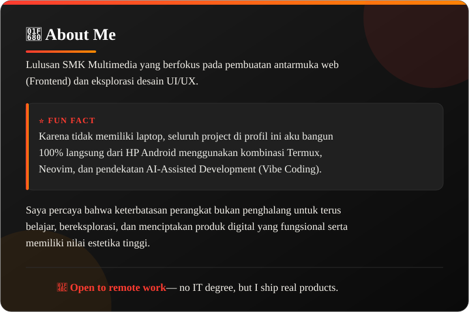

---

# 💫 About Me:
<h1 align="center">👋 Hi, I'm Akhmad Hadi!</h1>

<b>Frontend Developer | UI/UX Enthusiast | Multimedia Graduate</b>

---

---

### 🛠️ Tech Stack & Tools

**Web Development & UI/UX:**

**Mobile & AI:**

**Environment:**

---

### 📂 Featured Projects

<b>🎬 Mitsunime — Anime Streaming Website</b>

Website streaming anime subtitle Indonesia, dibangun full-stack langsung dari HP. Login Google, profil bergaya player card, server Node.js + SQLite. Live di [mitsunime.my.id](https://mitsunime.my.id).

*Tech:* Node.js, SQLite, JavaScript, HTML, CSS.

<b>📱 AnimeLovers — Android Anime App (Reborn)</b>

Membangun ulang aplikasi AnimeLovers v2.47 jadi aplikasi Android native (Kotlin). Streaming 720p, login Google & Facebook via Firebase, kill switch jarak jauh. v2.0.13 sudah jalan di HP.

*Tech:* Kotlin, Firebase, Media3, GitHub Actions.

<b>🤖 Mitsunime Android — Standalone Kotlin App</b>

Aplikasi Android mandiri untuk Mitsunime — langsung ke sumber, tanpa server, tanpa login. Player HD Media3, subtitle Indonesia, katalog 9.400+ judul.

*Tech:* Kotlin, Media3, Anikoto API.

<b>🏰 FATIH 1453 — Interactive Three.js Story</b>

Website cerita interaktif penaklukan Konstantinopel dengan scroll-driven Three.js, 9 adegan narasi Indonesia, musik mehter Ottoman, dan model 3D asli dari Blender.

*Tech:* Three.js, Blender, JavaScript.

<b>🛒 Game-Store & Admin Panel (Web App)</b>

Sebuah platform *e-commerce* untuk jual beli game. Dibangun dengan desain **Cyberpunk/Futuristic**. Website ini bersifat dinamis, terintegrasi dengan **Firebase** sebagai *backend*, dilengkapi fitur autentikasi (Login), dan memiliki Panel Admin terpisah untuk memonitoring toko.

*Tech:* HTML, Tailwind, Firebase, Google AI Studio.

<b>🏥 RS-Hadi (Interactive 3D Web)</b>

Project *work-in-progress* yang sedang saya kembangkan. Sebuah website interaktif layanan rumah sakit dengan visualisasi **Full 3D menggunakan Three.js**. Pengguna dapat melakukan *scroll* untuk menggerakkan kamera dan berinteraksi dengan objek 3D di dalamnya.

*Tech:* Three.js, HTML, CSS, JavaScript.

<b>🤖 AgentKu (Android AI Agent)</b>

Eksperimen pembuatan aplikasi Android (Native Kotlin) yang berfungsi sebagai asisten AI otonom. Dirancang untuk bisa mengontrol smartphone dan menjalankan tugas otomatis (seperti menjadwalkan dan membalas chat). Saat ini masih dalam tahap *debugging* (setengah jadi) namun APK sudah berhasil di-*install* di perangkat.

*Tech:* Kotlin, Google AI Studio, Android Studio.

<b>📺 Hadinimest (Anime Streaming UI)</b>

Sebuah *Live Demo* sederhana antarmuka (UI) untuk *streaming* anime. Dibuat untuk mengeksplorasi layout dan desain aplikasi *streaming* modern yang responsif.

*Tech:* JavaScript, HTML, CSS.

<b>🔗 Nexus-Project & Jettzennn.qzz.io</b>

Kumpulan eksperimen web statis. `Nexus-project` adalah tempat saya mengumpulkan *API endpoint*, sedangkan `jettzennn.qzz.io` adalah halaman *Linktree* pribadi yang saya gunakan sebagai pusat navigasi untuk proyek-proyek baca manga dan *streaming* anime.

*Tech:* HTML, JavaScript, CSS.

<b>📱 Grammar-Check-APK & Curry-Site & Myweb-Topup</b>

Kumpulan project eksplorasi awal dan eksperimen desain:

- **Grammar Check:** Aplikasi Android Native untuk mengecek tata bahasa, dibuat penuh menggunakan *prompt* di Google AI Studio.
- **Curry-Site:** Web portofolio sederhana bertemakan Stephen Curry.
- **Myweb-Topup:** Website statis pertama saya (Vibe Coding) menggunakan data *dummy* untuk layanan top-up.

*Tech:* Kotlin, HTML, CSS, JavaScript.

---

### 📊 GitHub Stats

---

<i>"Dibatasi oleh perangkat, tapi tidak dibatasi oleh imajinasi."</i>

# 💻 Tech Stack:
                             
# 📊 GitHub Stats:
 
 

---

<!-- Proudly created with GPRM ( https://gprm.itsvg.in ) -->
---

